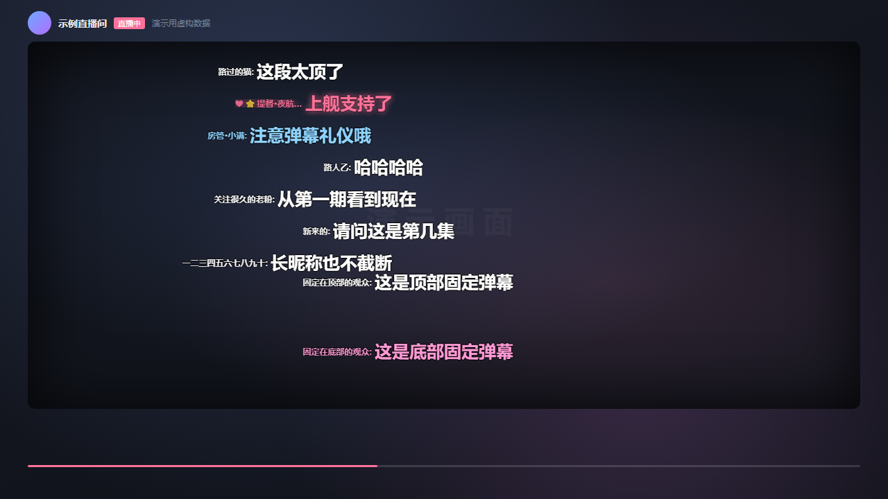

# B站直播画面弹幕昵称标注

给 B 站直播间**画面上飘过的弹幕**标上发送者昵称，并把值得注意的人一眼挑出来。

> 只改直播画面上的滚动/固定弹幕，不碰右侧聊天区，不改 B 站 自己的界面。



> 上图是用虚构数据渲染的示意图，不是真实直播间截图。

每版改了什么见 [CHANGELOG.md](CHANGELOG.md)。

---

## 它解决什么

B 站直播的弹幕飘过去只有正文，看不到是谁发的。这个脚本在每条弹幕前面补上「昵称:」，并按你的规则给特定的人加标记——粉丝多的大 V、你已经关注的人、你自己列的名单、粉丝牌高的、舰长、房管。

另外把「值得记下来」的弹幕自动收进记录面板，事后能搜、能筛、能导出。

---

## 功能

### 标注

| 能力 | 说明 |
|---|---|
| 昵称前缀 | 每条弹幕前插入「昵称:」，颜色和正文分开，不抢正文 |
| 粉丝数标注 | 粉丝 ≥ 阈值（默认 50000）打 ⭐ + 专属颜色 + 发光 |
| 已关注标注 | 当前登录账号已关注的人打 ❤ |
| 自定义名单 | 自己列的昵称或 UID 打 ◆，可单独配色 |
| 粉丝牌 | 显示牌子等级与牌名（默认关，长前缀会撑宽弹幕） |
| B 站等级 | Lv.N（默认关，Lv6 太普遍） |
| 舰长 / 提督 / 总督 | 压缩成单字标签 |
| 房管 | 压缩成单字标签 |
| 关键词高亮 | 命中关键词的弹幕换色 + 发光，关键词可单独指定颜色 |
| 表情弹幕 | 纯表情和图文混排也标昵称，且不撑大表情图 |
| 固定弹幕 | 顶部/底部固定弹幕（`-center`）同样标注，昵称越界时自动翻到右侧 |

### 悬停

鼠标停在一条弹幕上，**只暂停这一条**，弹出身份卡（头像、昵称、UID、粉丝数、等级、签名、空间链接）。移开恢复播放，不抢页面焦点。

### 记录面板

命中标注的弹幕自动收录，支持：

- 搜索：关键词 / 完全匹配 / 正则
- 按标签筛选（关注 / 粉丝 / 自定义 / 关键词）
- 导出到剪贴板
- 单条删除、批量选择删除
- 点名字跳 B 站空间

### 设置面板

悬浮球唤出，深浅双主题、可拖动、位置记忆。所有开关即时生效，屏上已有弹幕会立刻重画。

### 诊断

GM 菜单 → 「诊断导出」把现场状态复制到剪贴板：连接状态、包数、配对成功率、API 次数、画面盘点（文字/表情/混排/固定弹幕各漏几条）。B 站改版导致漏标时，先看这个。

---

## 安装

### 1. 装一个用户脚本管理器

[Tampermonkey](https://www.tampermonkey.net/)（Edge / Chrome / Firefox 均可）。

### 2. 装脚本

**方式 A：直接安装（推荐）**

打开下面的链接，Tampermonkey 会弹出安装页：

```
https://raw.githubusercontent.com/Loki-kiki/bili-danmaku-nickname/main/dist/bili-danmaku-nickname.user.js
```

**方式 B：从本仓库构建**

```bash
git clone https://github.com/Loki-kiki/bili-danmaku-nickname.git
cd bili-danmaku-nickname
node build.js
```

然后把 `dist/bili-danmaku-nickname.user.js` 拖进浏览器窗口。

### 3. 打开任意直播间

进 `https://live.bilibili.com/<房间号>`，脚本自动接管。左下角会出现一个悬浮球，点它开设置。

---

## 自动更新

脚本头部的 `@updateURL` / `@downloadURL` 指向本仓库 `dist/` 里的产物，Tampermonkey 会定期检查并提示升级。**每次改完记得重新构建并提交 `dist/`**，否则别人检查更新会显示「已是最新」但内容没变。

---

## 配置说明

设置面板里每一项都有说明。几个容易误解的：

| 项 | 默认 | 说明 |
|---|---|---|
| 粉丝数阈值 | 50000 | 调低会让更多普通用户带 ⭐，画面上会花 |
| 粉丝牌 / B站等级 / 舰长 / 房管 | 关 | 默认关是因为长前缀会把弹幕撑宽、同轨容易压字。需要时再开 |
| API 查询范围 | 都查 | 改成「只查值得的人」只对舰长/房管/高牌/名单发请求，省流量 |
| 昵称分隔符 | `:` | 可换成 `：`、空格等 |
| 主题 | 深色 | 面板配色，不影响弹幕本身 |

配置、用户缓存、记录都存在 Tampermonkey 的 GM 存储里，`@name` + `@namespace` 不变就能覆盖安装并继承。

---

## 工作原理（给想改代码的人）

```
src/
├─ 00-base.js      常量、运行态、选择器
├─ 05-util.js      文本归一、表情 key、格式化
├─ 10-config.js    默认配置 + 一次性迁移
├─ 12-md5.js       MD5（WBI 签名用）
├─ 15-protocol.js  HTTP / WBI 签名 / WS 弹幕流
├─ 20-api.js       API 队列：并发 + 优先级 + 风控退避 + 缓存
├─ 25-identity.js  弹幕包字段 → 身份对象（纯函数）
├─ 30-matcher.js   WS 弹幕 ↔ 画面 DOM 元素 配对
├─ 35-decorate.js  把昵称/徽章写进画面元素
├─ 40-hover.js     悬停暂停 + 身份卡
├─ 45-track.js     场次统计 / 指定人进场
├─ 50-records.js   高亮记录
├─ 55-panel.js     悬浮球 + 设置面板 + 记录面板
└─ 70-main.js      装配入口
```

几条踩出来的硬约束：

1. **状态一律存 WeakMap，不用 dataset。** B 站 会重写弹幕元素的 `innerHTML` 和 `style`，dataset 会跟着丢；丢了就补不回来，表现为「有时候没标」。
2. **昵称绝对定位，不能内联。** B 站 用固定时长滚动，元素越宽滚得越快。内联昵称会撑宽元素 → 跑得更快 → 追上同轨前一条 → 压字。绝对定位不占布局宽度，速度计算完全不受影响。
3. **零成本字段优先。** `DANMU_MSG` 包自带粉丝牌、等级、舰长、房管，一条 API 都不用调。只有粉丝数和关注关系才需要请求。
4. **配对要按「出生」追，不能按快照判。** 弹幕元素是池化复用的，同一个 div 换文字重新滚。判「新弹幕」看的是进入活动态或正文变了，不是节点被插入。
5. **固定弹幕单独算。** `-center` 静止居中，按滚动逻辑算可用间隙恒接近 0，会被误判成没地方放昵称。

---

## 开发

```bash
npm run build   # 构建到 dist/，并做语法检查 + 版本一致性 + 发布通道校验
npm test        # 纯逻辑回归，不需要浏览器
```

`build.js` 会把 `src/*.js` 按依赖顺序拼成一个 IIFE，版本号唯一来源是 `version.js`（同时注入 `@version` 和代码里的 `VERSION` 常量，不一致直接构建失败）。

### 本地演示页

`docs/demo/` 是一个不连网的演示页，用虚构数据模拟直播间，用来验证标注渲染：

```bash
python docs/demo/serve.py
# 打开 http://127.0.0.1:8932/10000000/index.html
```

页面上调 `window.__demo()` 会灌入一批假弹幕，脚本照常配对标注。

---

## 已知限制

- 只在 B 站直播页生效（`https://live.bilibili.com/*`），不处理视频页弹幕。
- 粉丝数和关注关系要靠 API 查，大直播间人多时会有延迟（队列有并发上限和风控退避）。零成本字段（粉丝牌/等级/舰长/房管）不受影响。
- B 站改版会导致选择器失效。遇到漏标先点面板诊断，里面会打印实际命中的选择器与各类漏标数。
- 没有 Tampermonkey 的环境（比如某些自动化浏览器）需要自己补 GM_* 垫片，见 `docs/demo/10000000/index.html`。

---

## 许可

MIT
